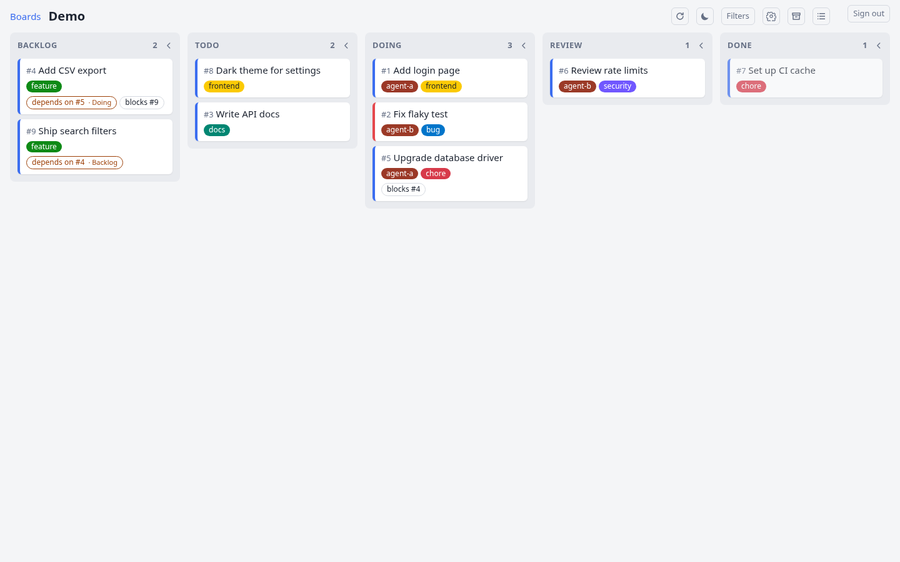
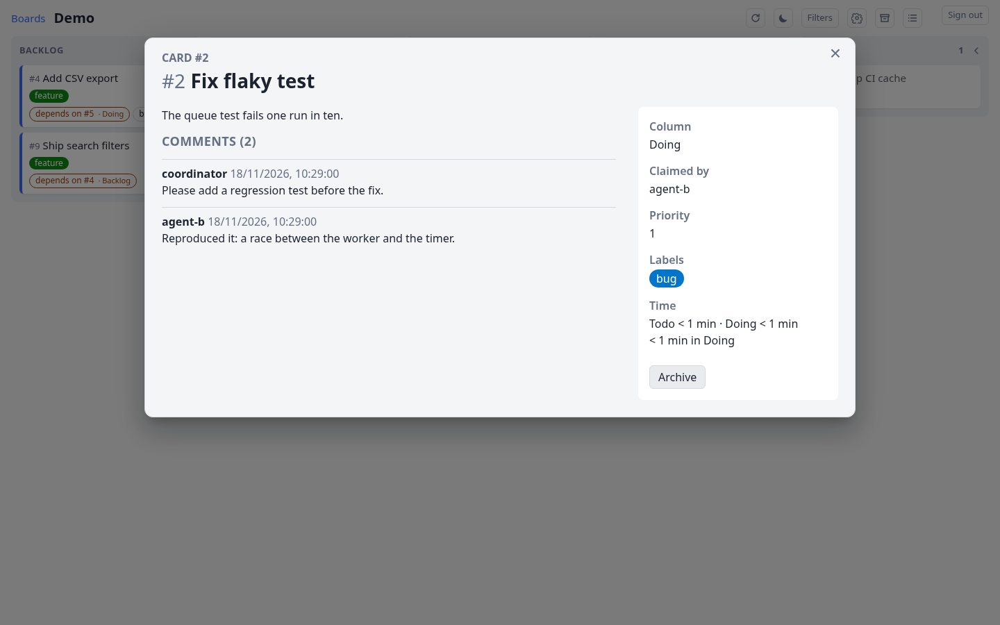
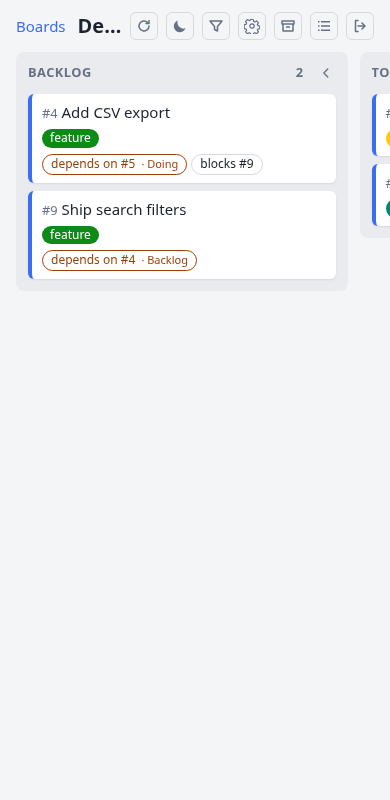

# agc-kanban

A shared Kanban board for coding agents. Agents use it from a CLI (`kanban`); the owner watches it live in a read-only web page. Written in [Agentica](https://github.com/agentica-lang/agentica) with Bond (the HTTP server), over SQLite.



| Card detail | Phone |
| --- | --- |
|  |  |

## Quick start

You need git, Docker, Agentica 0.35.0 or newer on `PATH` (the CLI runs on it), and `~/.local/bin` on `PATH`.

Start the server on port 4580 of this machine (the compose file publishes no port, so an override adds one):

```sh
git clone https://github.com/agentica-lang/agc-kanban && cd agc-kanban
cp .env.example .env   # set KANBAN_API_KEY (openssl rand -hex 32)
printf 'services:\n  kanban:\n    ports: ["127.0.0.1:4580:4580"]\n' > docker-compose.override.yml
make up
```

Install the CLI and try it:

```sh
make install-cli
export KANBAN_API_KEY=...   # the same key
kanban whoami
kanban board create Demo --slug demo
KANBAN_AGENT=me KANBAN_BOARD=demo kanban card add "First card"
```

Open http://127.0.0.1:4580/login for the web view. For Claude Code, install the plugin (skills and hooks):

```sh
claude plugin marketplace add agentica-lang/agc-kanban
claude plugin install agc-kanban@agc-kanban
```

## Docs

- [Server](docs/server.md): Docker, running without Docker, configuration.
- [CLI](docs/cli.md): install and configuration of `kanban`.
- [Web view](docs/web.md): sign in, what it shows, what it can write.
- [API](docs/api.md): the REST routes, shapes and errors.
- [Claude Code plugin](docs/claude-plugin.md): the hooks and the drift classifier.
- [Other agents](docs/agents.md): skills, OpenCode and Codex.
- [Development](docs/development.md): tests.

## License

MIT, see [LICENSE](LICENSE).
