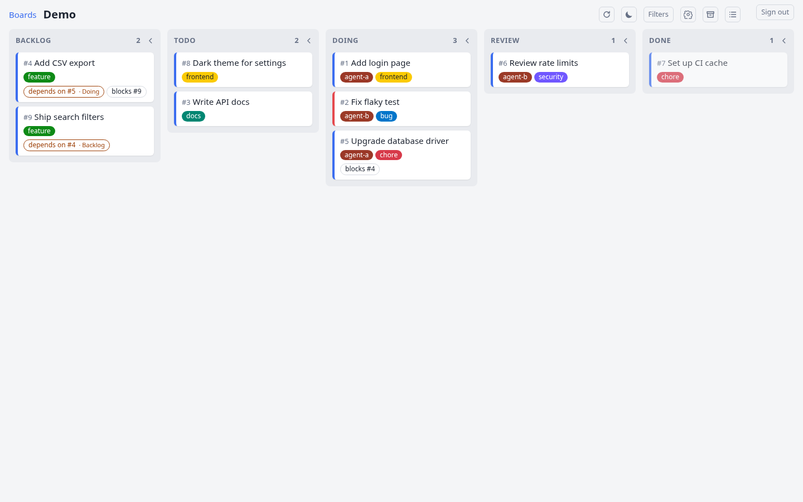

# Web view

The web view is a Vue 3 app in `app/`, built with pnpm and Vite (`make assets`; the Docker image builds it in a Node stage, and the runtime image has no Node). The build output is not in git. For a reload while you edit, run `make assets` under `entr -r`.

## Sign in

Open `/login`. The web signs in with a username and a password; the API key is for the CLI and the API, and it does not sign in to the web. The first time, when no user exists, the login page is a form that creates the first user (a username of 3 to 32 letters, numbers, dots, dashes or underscores, and a password of 8 to 16 characters with an uppercase letter, a lowercase letter, a number and a special character): whoever opens the page first registers it and is signed in. Once a user exists, registration is closed and the page shows only the sign-in form (a user is not added from the web afterwards).

Passwords are kept as a scrypt hash with a salt. The password rules are checked on the server: any character that is not an ASCII letter or digit counts as special, and the length counts characters.

Login tries are limited in memory, per window of five minutes: 30 per address, 5 per username and address, and 50 per username from all addresses, then 429 with `Retry-After`; at most four passwords are hashed at once, and a login that finds them busy gets 429 at once, so a flood of logins does not stall the CLI. The address is the address of the TCP peer (`remote_addr`): behind a reverse proxy every client has the address of the proxy and the address limit becomes one limit for everybody (no `X-Forwarded-For` is read). Sign out ends the session on the server and closes its live sockets.

## What it shows and what it writes

The pages are view-only, except for two things the owner approved: a label color (the color input beside each label in the Filters drawer) and archiving (the Archive button in a card's panel, and the Archive drawer, which archives the done cards older than N days, 3 by default, lists the archived cards and unarchives one). The session may make only these writes: `PATCH /api/labels/:id` (the color), `POST /api/cards/:id/archive` (never with `force`), `POST /api/cards/:id/unarchive` and `POST /api/boards/:board/archive-done`.

## Views

The pages show boards, cards and a live activity feed, with filters by label, agent and ready, and a search box in the Filters drawer (`/` opens it; Escape clears it), all in the URL, so a link keeps them. The search ranks the cards with SQLite FTS5 and `bm25` (the title counts most) over the title, body, labels and comments; `kanban card search QUERY` and `GET /api/boards/:slug/search?q=` give the same order. A card opens in a side panel (`?card=N` in the URL): each card you open is a step in the browser history, so Back and Forward walk through them.

Every other write goes through the CLI or the API (`kanban card archive ID` hides a card, `kanban card unarchive ID` brings it back, `kanban board archive-done --days 3` archives the old done cards, `kanban board auto-archive --days 7` makes the server do it every ten minutes (off by default), `kanban card list --archived` lists them).

## Labels, relations and display

Each label of a board has a color (`kanban label list`, `kanban label update NAME --color '#rrggbb'`): a new label gets one from a GitHub-like palette, and the chips on the cards use it. A card shows chips for the cards it depends on (with the column of each) and the cards it blocks; hovering or focusing a card marks its related cards and dims the rest, and a chip goes to its card.

The gear button in the header opens the display settings: the relation chips, the lines between related cards (off by default), the labels, the claimed agent, the links, the time in the column and a preview of the body, kept per board in the browser's localStorage like the collapsed columns. The board snapshot carries `column_since` (since when each card is in its column) for the time in the column.

The chevron in a column's header collapses the column to a narrow strip with its name and its card count, and a click on the strip opens it again; which columns are collapsed is kept per board in the browser's localStorage, not on the server.

Behind HTTPS, set `KANBAN_COOKIE_SECURE=1` (see [server.md](server.md)).
